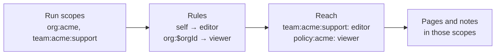

# Knowledge concepts

:::warning

Knowledge is experimental and can change without notice.

:::

Knowledge keeps three things apart: **who a run is**, **what each scope allows**, and **what's stored**. The host sets the first, your declarations decide the second, and the model only works with the third.

## Scopes

A **scope** is a boundary for content, written as an address such as `org:acme`, `team:acme:support` or `resource:dana`. The first segment is the scope's type, and the rest are its values.

Every scope is also a page. Reading `org:acme` shows the pages that live in it and the scopes placed under it. Together the scopes form a tree the model can browse.

## Run scopes

A run's **run scopes** say who it is. They come from the host: the agent's `scopes`, the `scopes` passed to a call, or the request context. With Memory, a run also holds `resource:<resourceId>` and `thread:<threadId>`.

```typescript
await agent.generate('How do I handle a chargeback?', {
  scopes: ['org:acme', 'role:acme:support', 'team:acme:support'],
  memory: { resource: 'dana', thread: 'ticket-91' },
})
```

This run is Dana, in the Acme org, with the support role, on the support team. The model can't add to its run scopes or change them.

Holding a scope grants nothing by itself. A run holding `team:acme:support` can only read or write there if a rule gives it a role. When Knowledge is attached, every run scope must match a declared scope type, or the tools fail with:

```text
Knowledge run scope "project:x" does not match a declared scope type.
```

## Rules and roles

You declare scope types on the `Knowledge` instance. Each declaration can carry **rules**: a principal (a scope pattern, or `self`) and the role it gets on scopes of that type.

```typescript oxfmt:false
scopes: {
  ...knowledgeMemoryScopes(),
  'role:$orgId:support': {},
  'team:$orgId:$teamId': {
    access: [{ principal: 'self', role: 'editor' }],
  },
  'policy:$orgId': {
    access: [{ principal: 'org:$orgId', role: 'viewer' }],
  },
}
```

A run holding `team:acme:support` is an editor there because of the `self` rule. A run holding `org:acme` can read `policy:acme`, because `$orgId` binds from the policy's own address, but not `policy:globex`. See [declare scope types](/docs/knowledge/scope-types) for patterns, binding and templates.

Each role includes the ones before it:

| Role | Can |
| - | - |
| `viewer` | Search and read pages and notes |
| `contributor` | Create pages and add notes |
| `editor` | Edit a page's name, description and body, move pages within a scope, restamp and remove notes, and pin pages |
| `owner` | Move pages to another scope and merge pages away |

## What a run can reach

Knowledge works out a run's reach each time a tool runs:

1. Start with the run scopes.
1. Find every rule whose principal matches one of them, and give the run that rule's role on the scopes it covers.
1. Stop there. A scope reached through a rule doesn't act as a principal itself, so access never chains through a second hop.



There's no inheritance either. A role on `org:acme` gives nothing on scopes placed under it unless a rule says so.

Anything outside a run's reach looks absent. A page the run can't read comes back as `Knowledge page "Chargeback Playbook" not found.`, the same as a page that doesn't exist. A write that's in reach but needs a stronger role names the role it needs:

```text
Editing a page needs editor on "policy:acme"; this run has viewer there.
```

## Pages

A **page** is a topic with a name, a short description and a body. Each page has one home scope and can sit under a parent page. A scope holds a tree of pages. The body is the curated summary of the topic, and only editors change it.

Tools refer to a page by its ID, by `<scope>#<key>` for pages created with a key (such as `policy:acme#refund-policy`), or by its exact name. A name that matches more than one readable page is refused with the candidate IDs.

## Notes

A **note** is a short fact added to a page, such as a detail someone else should be able to rely on later. Notes record who wrote them, and contributors can add them without being able to edit the page body.

Every note is **stamped** with one or more scopes that decide who sees it. A note is visible when its page is visible and the run can read at least one of its stamps. An agent can add a note stamped `agent:acme:alex` to a page in `org:acme`, and only runs that can read `agent:acme:alex` see it.

A note can mention another page as `[[Page Name]]`. Reading the mentioned page lists the notes that mention it.

## Pins

A **pin** puts a page into the context of every run in an audience, every turn. Pins need Memory and `pinnedContext`. See [pins](/docs/knowledge/pins).
