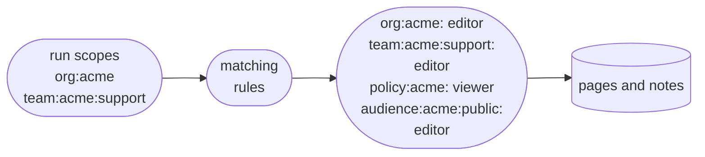

# Scopes and access

Scopes control what an agent can see and change in Knowledge. You decide what each kind of scope allows. Your server decides which scopes each run, or agent call, holds. The model works only with the pages and notes those scopes give it, and it can't change either decision.

:::alpha

Knowledge is in alpha. Its API may change between releases. Access is checked on every tool call, but the alpha doesn't guarantee isolation between scopes yet. Don't store anything in Knowledge that must never reach another customer or user.

:::

## Declare scopes

A **scope** is an area of Knowledge that holds pages and notes. Each scope has an address, such as `org:acme`, `team:acme:support` or `resource:dana`. The part before the first colon is the scope's type, such as `team`. The rest identifies one scope of that type.

Knowledge has no built-in scope types. You declare the types you need in the `scopes` option on `Knowledge`. Each type is a pattern, such as `team:$orgId:$teamId`. A `$name` segment is a placeholder that matches any value. The address `team:acme:support` matches that pattern with `$orgId = acme` and `$teamId = support`.

The example sets up these rules:

- Members of a support team can edit their team's pages.
- Everyone in the org can read the team's pages and the company policies.
- Org members can write public pages, which a public FAQ agent reads.
- Other orgs can't see any of it.

```typescript title="src/mastra/knowledge.ts"
import { Knowledge, knowledgeMemoryScopes } from '@mastra/core/knowledge'
import { LibSQLStore } from '@mastra/libsql'

export const knowledge = new Knowledge({
  id: 'company',
  storage: new LibSQLStore({ id: 'knowledge', url: 'file:./knowledge.db' }),
  tools: true,
  scopes: {
    ...knowledgeMemoryScopes(),
    'team:$orgId:$teamId': {
      description: 'A team',
      belongsTo: 'org:$orgId',
      access: [
        { principal: 'self', role: 'editor' },
        { principal: 'org:$orgId', role: 'viewer' },
      ],
    },
    'policy:$orgId': {
      description: 'Company policies',
      access: [{ principal: 'org:$orgId', role: 'viewer' }],
    },
    'audience:$orgId:public': {
      description: 'Pages for public visitors',
      access: [
        { principal: 'self', role: 'viewer' },
        { principal: 'org:$orgId', role: 'editor' },
      ],
    },
  },
})
```

[`knowledgeMemoryScopes()`](/reference/knowledge/knowledge-memory-scopes) adds three types: `org:` for each organization, plus Memory's `resource:` type for users and `thread:` type for conversations. A run is the owner of the `resource:` and `thread:` scopes it holds, and an editor of its `org:` scope. The FAQ agent in [For one agent](#for-one-agent) reads the `audience:` scope.

## Access rules and roles

Each declaration's `access` list says who gets which role on scopes of that type. Each entry is a **rule** with a `principal` and a `role`. The principal says which runs the rule applies to. A rule applies to a run when the run holds a scope that matches the principal. A principal is either `self` or one of your declared patterns. In the `team:$orgId:$teamId` declaration:

- `self` means the team scope that's being accessed. A run holding `team:acme:support` is an editor there.
- `org:$orgId` means the team's own org, because it reuses the team's `$orgId`. A run holding `org:acme` can read `team:acme:support`, but not `team:globex:support`.

Each role can do everything the roles above it can:

| Role | Can |
| - | - |
| `viewer` | Search and read pages and notes |
| `contributor` | Create pages and add notes |
| `editor` | Edit pages, move them within a scope, change who can see a note, remove notes, and pin pages |
| `owner` | Move pages to another scope, merge a page into another page, and delete pages |

`belongsTo` puts a scope under another scope in the tree, like a folder inside a folder. It doesn't give any access on its own. Declarations can also add template pages, child scopes and a display label. [Scope declarations](/reference/knowledge/scope-declarations) lists every field and the errors Knowledge reports at startup.

## Set a run's scopes

**Run scopes** are the scopes a run holds. They identify the user, team or conversation the run works for. Only your server code sets them. The model can't change them, and a client can't send them in a request body.

A run gets a role in a scope only when a rule gives it one. Every run scope must also match a declared type, or the Knowledge tools fail.

### From your server

Your server knows who the user is. Set the user's scopes in middleware, on the `MASTRA_SCOPES_KEY` request context key, as strings such as `org:acme`. In this example, `getUser()` is your app's own login lookup, and `support` is an agent with Knowledge attached:

```typescript title="src/mastra/index.ts"
import { Mastra } from '@mastra/core/mastra'
import { MASTRA_RESOURCE_ID_KEY, MASTRA_SCOPES_KEY } from '@mastra/core/request-context'

export const mastra = new Mastra({
  agents: { support },
  server: {
    middleware: [
      async (c, next) => {
        const user = await getUser(c.req.header('Authorization'))
        const requestContext = c.get('requestContext')

        requestContext.set(MASTRA_SCOPES_KEY, [
          `org:${user.orgId}`,
          ...user.teams.map(team => `team:${user.orgId}:${team}`),
          `resource:${user.id}`,
        ])
        requestContext.set(MASTRA_RESOURCE_ID_KEY, user.id)

        await next()
      },
    ],
  },
})
```

Also set `MASTRA_RESOURCE_ID_KEY` to the user's ID. The server then checks thread ownership against the same user. See [request context](/docs/server/request-context#reserved-keys).

### In a direct agent call

When your code calls the agent directly, pass the scopes in the `scopes` option:

```typescript
await support.generate('How do I handle a chargeback?', {
  scopes: ['org:acme', 'team:acme:support'],
  memory: { resource: 'dana', thread: 'ticket-91' },
})
```

With Memory, the run also holds the `resource:` and `thread:` scopes from the `memory` option, here `resource:dana` and `thread:ticket-91`. A run can hold only one of each. If you pass a `resource:` scope that differs from `memory.resource`, the run fails. Pass raw IDs. Knowledge encodes them for you.

### For one agent

An agent's `scopes` option changes the scopes for that agent's runs. A list adds to the scopes from the request context and the call. A function receives those scopes and returns the final list, so it can give an agent less access than the user has. This public FAQ agent replaces the user's `org:` scope with the org's `audience:` scope, so it reads the org's public pages but none of its other pages. It keeps the user's `resource:` and `thread:` scopes, so it can still read pages in those:

```typescript
export const faq = new Agent({
  id: 'faq',
  name: 'FAQ',
  instructions: 'You answer public questions about Acme.',
  model: '__GATEWAY_OPENAI_MODEL__',
  knowledge,
  memory,
  scopes: ({ scopes }) =>
    scopes.flatMap(scope => {
      if (scope.startsWith('org:')) return [`audience:${scope.slice(4)}:public`]
      if (scope.startsWith('resource:') || scope.startsWith('thread:')) return [scope]
      return []
    }),
})
```

The function must return every `resource:` and `thread:` scope it receives. Memory uses them to identify the user and thread. The run fails if one is missing.

## How access is decided

Each time a tool runs, Knowledge works out which scopes the run can reach and with which role:

1. It starts with the run scopes.
1. It finds every rule whose principal matches one of those scopes, and gives the run that rule's role.
1. It stops there. A role from a rule doesn't lead to more roles.

For example, for a run holding `org:acme` and `team:acme:support`:



Scopes don't inherit access either. A role in `org:acme` gives nothing in the scopes placed under it unless a rule says so.

To a run, anything outside its reach looks like it doesn't exist. A hidden page looks the same as a missing one. When the run can reach a scope but its role is too weak, the error says which role it needs.

### Note visibility

Each note is **stamped** with one or more scopes. A run sees a note only when it can read the page and at least one of the note's stamps. The run doesn't have to hold the stamp. When the note links to other pages with `[[...]]`, the run also needs to be able to read the scope of each linked page, though a link that matches no page is ignored. For example, on a team page:

- A note stamped `resource:dana` is visible only to Dana's runs, because only they can read `resource:dana`.
- A note stamped `team:acme:support` is visible to every run that can read the team scope. With the rules above, that's the whole of `org:acme`, not only the team.

### Test access with `explainAccess()`

[`explainAccess()`](/reference/knowledge/knowledge-class#explainaccess) takes a list of run scopes and a scope or page. It returns the role those run scopes have there, and the rules that give it.

Rules that bind from a scope's address, like all of the rules above, depend only on your declarations. A test can check them without calling a model or writing pages. A rule that binds through a scope's [place in the tree](/reference/knowledge/scope-declarations#place-scopes-with-belongsto) gives no role until a writing run has placed the scope, so test those after a write:

```typescript title="src/mastra/knowledge.test.ts"
import { describe, expect, it } from 'vitest'
import { knowledge } from './knowledge'

const roleOn = async (scopes: string[], scope: string) =>
  (await knowledge.explainAccess(scopes, { scope })).role

describe('team access', () => {
  it('lets a team edit its own scope', async () => {
    expect(await roleOn(['org:acme', 'team:acme:support'], 'team:acme:support')).toBe('editor')
  })
  it('lets the org read it', async () => {
    expect(await roleOn(['org:acme'], 'team:acme:support')).toBe('viewer')
  })
  it('hides it from another org', async () => {
    expect(await roleOn(['org:globex'], 'team:acme:support')).toBeNull()
  })
})
```

:::warning

Use `explainAccess()` only in server code. It shows whether a page is missing or hidden, and a run must never learn that. Don't expose it through an agent tool, or through a server route without admin-level auth.

:::

## Next steps

Next, [give an agent the Knowledge tools](/docs/knowledge/agents-and-tools) so it can search, read and write in the scopes its runs hold.
