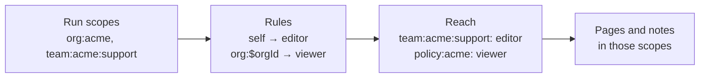

# Scopes and access

Knowledge keeps three things apart:

- **Who a run is**, set at runtime by your server code.
- **What each scope allows**, set in your Knowledge config.
- **What's stored**, the pages and notes the model reads and writes.

The model works only with what's stored. It can't change who the run is or what a scope allows.

:::alpha

Knowledge is in alpha. Its API may change between releases.

:::

## Scopes

A **scope** is a place content lives, written as an address such as `org:acme`, `team:acme:support` or `resource:dana`. The first segment is the scope's type, and the rest are its values. Every scope is also a page: reading `org:acme` lists the pages in it and the scopes placed under it, so the model can browse the scopes as a tree.

You name the types. Knowledge has none built in, and the `scopes` option on `Knowledge` declares each type a run can hold, as a pattern with `$params`:

```typescript title="src/mastra/knowledge.ts"
import { Knowledge, knowledgeMemoryScopes } from '@mastra/core/knowledge'
import { LibSQLStore } from '@mastra/libsql'

export const knowledge = new Knowledge({
  id: 'company',
  storage: new LibSQLStore({ id: 'knowledge', url: 'file:./knowledge.db' }),
  tools: true,
  scopes: {
    ...knowledgeMemoryScopes(),
    'team:$orgId:$teamId': {
      description: 'A team',
      belongsTo: 'org:$orgId',
      access: [
        { principal: 'self', role: 'editor' },
        { principal: 'org:$orgId', role: 'viewer' },
      ],
    },
    'policy:$orgId': {
      description: 'Company policies',
      access: [{ principal: 'org:$orgId', role: 'viewer' }],
    },
  },
})
```

[`knowledgeMemoryScopes()`](/reference/knowledge/knowledge-memory-scopes) declares Memory's `resource:` and `thread:` scopes and an `org:$orgId` tenant scope, and makes each run an editor on the ones it holds.

## Rules and roles

Each declaration lists `access` **rules**. A rule gives a role on scopes of this type to a **principal**: the run scope that has to be in a run for the rule to apply. A principal is written as a declared scope pattern, such as `org:$orgId`, or as `self`, which stands for the scope being accessed. Any run holding a scope that matches the principal gets the role:

- `self` means the same scope: a run holding `team:acme:support` is an editor there.
- `org:$orgId` binds `$orgId` from the team's address, so a run holding `org:acme` can read `team:acme:support` but never `team:globex:support`.

Each role includes the ones before it:

| Role | Can |
| - | - |
| `viewer` | Search and read pages and notes |
| `contributor` | Create pages and add notes |
| `editor` | Edit pages, move them within a scope, restamp and remove notes, and pin pages |
| `owner` | Move pages to another scope, merge pages away and delete pages |

`belongsTo` places a scope under another one in the tree. It grants nothing by itself. Declarations can also give each scope template pages, child scopes and a label for UIs. See [Scope declarations](/reference/knowledge/scope-declarations) for every field, how params bind, and the startup errors.

## Set who a run is

A run's **run scopes** say who it is. They always come from host code. The model can't add to them or change them, and a client can't send them in a request body.

Your server knows who the user is, so set their scopes in middleware, as plain `<type>:<value>` strings on the `MASTRA_SCOPES_KEY` request context key:

```typescript title="src/mastra/index.ts"
import { Mastra } from '@mastra/core/mastra'
import { MASTRA_RESOURCE_ID_KEY, MASTRA_SCOPES_KEY } from '@mastra/core/request-context'

export const mastra = new Mastra({
  agents: { support },
  server: {
    middleware: [
      async (c, next) => {
        const user = await getUser(c.req.header('Authorization'))
        const requestContext = c.get('requestContext')

        requestContext.set(MASTRA_SCOPES_KEY, [
          `org:${user.orgId}`,
          ...user.teams.map(team => `team:${user.orgId}:${team}`),
          `resource:${user.id}`,
        ])
        requestContext.set(MASTRA_RESOURCE_ID_KEY, user.id)

        await next()
      },
    ],
  },
})
```

Set `MASTRA_RESOURCE_ID_KEY` alongside the scopes so the server's thread ownership checks use the same user. See [request context](/docs/server/request-context#reserved-keys).

In code that calls the agent directly, pass the same list as `scopes` on the call:

```typescript
await support.generate('How do I handle a chargeback?', {
  scopes: ['org:acme', 'team:acme:support'],
  memory: { resource: 'dana', thread: 'ticket-91' },
})
```

With Memory, a run also holds `resource:<resourceId>` and `thread:<threadId>`. A run has one of each, and a `resource:` scope that disagrees with `memory.resource` fails the run. Pass raw IDs: Knowledge encodes them, so a user ID of `acme/dana` becomes `resource:acme%2Fdana`.

Holding a scope grants nothing by itself, and every run scope must match a declared type. An undeclared one fails the tools with `Knowledge run scope "project:x" does not match a declared scope type.`

### Add or narrow scopes per agent

A list in the agent's `scopes` option adds to the scopes from the request context and the call. A function receives the incoming scopes and returns the run's final set, which lets you give an agent less than the user has. Here a public FAQ agent swaps the org for a public audience scope that rules grant narrowly:

```typescript
export const faq = new Agent({
  id: 'faq',
  name: 'FAQ',
  instructions: 'You answer public questions about Acme.',
  model: '__GATEWAY_OPENAI_MODEL__',
  knowledge,
  memory,
  scopes: ({ scopes }) =>
    scopes.flatMap(scope => {
      if (scope.startsWith('org:')) return [`audience:${scope.slice(4)}:public`]
      if (scope.startsWith('resource:') || scope.startsWith('thread:')) return [scope]
      return []
    }),
})
```

The function has to keep every `resource:` and `thread:` scope it receives. They're the run's Memory identity, and dropping one fails the run.

## What a run can reach

Knowledge works out a run's reach each time a tool runs:

1. Start with the run scopes.
1. Find every rule whose principal matches one of them, and give the run that rule's role on the scopes it covers.
1. Stop there. A scope reached through a rule doesn't act as a principal itself, so access never chains through a second hop.

For a run holding `org:acme` and `team:acme:support`:



There's no inheritance either. A role on `org:acme` gives nothing on scopes placed under it unless a rule says so.

Anything outside a run's reach looks absent. A page the run can't read comes back as `Knowledge page "Chargeback Playbook" not found.`, the same as a page that doesn't exist. A write that's in reach but needs a stronger role names the role it needs:

```text
Editing a page needs editor on "policy:acme"; this run has viewer there.
```

## Pages and notes

A **page** has a name, a short description and a markdown body. It has one home scope and can sit under a parent page. The pages in a scope form a tree. Tools refer to a page by its ID, its exact name, or its path: the scope address, `#`, then the page keys from the top down, as in `org:acme#policies/refund`.

A **note** is a short fact added to a page, with its author. Contributors can add notes without being able to edit the page body. Every note is **stamped** with one or more scopes, and a run sees it when it can read the page and holds at least one stamp. A note on a team page stamped `resource:dana` reaches only Dana's runs. A note stamped with both `resource:dana` and `team:acme:support` reaches Dana and her team.

A note can link another page as `[[org:acme#policies/refund]]` or `[[Page Name]]`, and reading the linked page lists the notes that mention it.

## Check what a run can reach

`explainAccess()` takes raw run scopes and a scope or page, and returns the role those scopes have there and the rule that grants it:

```typescript
await knowledge.explainAccess(['org:acme'], { scope: 'team:acme:support' })
// { role: 'viewer', reasons: [{ principal: 'org:acme', role: 'viewer', rule: 'team:$orgId:$teamId', via: 'rule' }] }

await knowledge.explainAccess(['org:globex'], { scope: 'team:acme:support' })
// { role: null, reasons: [], reason: 'no-rule' }
```

Access comes from config, so a test can check each rule without running a model or writing pages:

```typescript title="src/mastra/knowledge.test.ts"
import { describe, expect, it } from 'vitest'
import { knowledge } from './knowledge'

const roleOn = async (scopes: string[], scope: string) =>
  (await knowledge.explainAccess(scopes, { scope })).role

describe('team access', () => {
  it('lets a team edit its own scope', async () => {
    expect(await roleOn(['org:acme', 'team:acme:support'], 'team:acme:support')).toBe('editor')
  })
  it('lets the org read it', async () => {
    expect(await roleOn(['org:acme'], 'team:acme:support')).toBe('viewer')
  })
  it('hides it from another org', async () => {
    expect(await roleOn(['org:globex'], 'team:acme:support')).toBeNull()
  })
})
```

:::warning

`explainAccess()` is for host code only. It tells a missing page from a hidden one, which a run must never learn. Never expose it through an agent tool, or through a server route without admin-level auth.

:::

## Related

- [What you can build](/docs/knowledge/patterns)
- [Scope declarations](/reference/knowledge/scope-declarations)
- [`explainAccess()`](/reference/knowledge/knowledge-class#explainaccess)
- [Request context](/docs/server/request-context)
